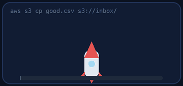
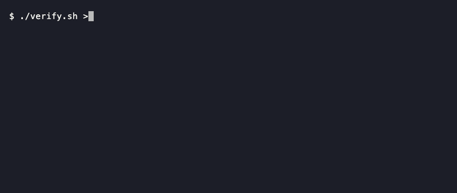
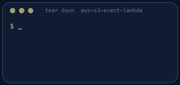

<p align="center"></p>

| | |
|-|-|
| **Time** | 75-90 min |
| **Cost** | free (a few requests) |
| **You need** | An AWS administrator user, the AWS CLI v2 configured for it, Python 3.11+ and a terminal |

## How this lab works

1. **Fork** this repository to your own GitHub account (button at the top right).
2. Clone **your fork** in your Ubuntu environment (WSL on Windows, your OrbStack machine on Mac).
3. Read the lab below (the same text is in [`LAB.md`](LAB.md)) and follow the mission.
4. Answer the questions in [`SUBMISSION.md`](SUBMISSION.md). Where a question asks for output, paste it in a code block. No screenshots needed.
5. Commit and push. Open the **Actions** tab of your fork (click *I understand my workflows, go ahead and enable them* the first time). The **Lab check** shows what is still missing.
6. When the check is green, **submit the URL of your fork** in the course platform.

> [!NOTE]
> The check only looks at your answers and any files the lab asks you to commit. Your instructor reads your work and may ask you to explain any line.

<p align="center"></p>

## 🎬 The situation

<p align="center"></p>

Clippy's partners send CSV files of links they want shortened: a short code and a URL per line. Today those files arrive by e-mail, and an intern opens each one, squints at it, and fixes the typos. Last month a file with a wrong header was imported anyway and 4,000 links went to the wrong place.

You will turn an S3 bucket into an **inbox that processes itself**. A partner drops `anything.csv` into `inbox/`. A Lambda function wakes up, checks the file and writes a **report** (how many rows, how many valid, which lines are wrong) into `processed/`, or an **error note** into `rejected/` if the file is unusable. Nobody clicks anything.

It sounds like ten lines of code. It is not, for three reasons you will meet: the function must have permission for **exactly** what it does and nothing more, S3 must be allowed to **call** the function (a permission you do not set on the function's role), and a function that writes into the bucket that triggers it can **start itself forever**.

> [!IMPORTANT]
> **Your mission**
> - Write the function's logic and make 14 local tests pass, with no AWS account involved
> - Create the bucket and the function, and a role that can read `inbox/`, write `processed/` and `rejected/`, and **nothing else**
> - Connect the bucket to the function with a **filtered** notification, and let S3 invoke it
> - Upload real files, including nasty ones, and watch the logs
> - Tear everything down and prove it

**Time:** 75-90 min | **Cost:** free (a few requests) | **You need:** an AWS administrator user, the AWS CLI v2 configured for it, Python 3.11 or newer and a terminal.

<p align="center"></p>

## Part 0 - Read before you write

Fork this repository and clone your fork. Open `handler.py`: the top of the file describes the **event** S3 sends and the exact output expected. Open `samples/`: three CSV files, one clean, one with a wrong header and one with several kinds of bad rows.

> [!NOTE]
> **Think** The event contains the object's **key** as a URL-encoded string. A file named `my file+1.csv` arrives as `my+file%2B1.csv`. If your code ignores that, what happens the first time a partner uses a space in a file name? (This one bug has broken more S3 pipelines than anything else.)

<p align="center"></p>

## Part 1 - The logic, locally

`process()` is a plain function: text in, result out. `lambda_handler()` reads from S3, calls it, writes the answer back. Write both (the TODOs say what), and run the tests until all 14 are green:

```bash
python3 -m unittest discover -s tests -v
```

The tests replace S3 with a tiny fake, so you need no AWS account yet. Read the tests: they are the specification, including the ones that look odd (a quoted comma inside a URL, Windows line endings, a file that is not UTF-8, the same event delivered twice).

> [!NOTE]
> **Predict** The test `test_other_keys_are_ignored` sends your function a record for `processed/x.json`. You are going to configure S3 so that this never happens. Why does the code check anyway? (Hint: defence in depth. Which of the two layers fails more quietly?)

<p align="center"></p>

## Part 2 - The bucket and the role

Everything is named after `clippy-inbox` and tagged `lab=aws-s3-event-lambda`.

1. Create the bucket `clippy-inbox-<your account id>`. Keep **all four "block public access" settings on**. Tag it.
2. Create the **role** `clippy-inbox-role`. Lambda may assume it. Attach the AWS managed policy `AWSLambdaBasicExecutionRole` (so the function can write its logs) and add **one inline policy** with:
   - `s3:GetObject` on `inbox/*` of this bucket only;
   - `s3:PutObject` on `processed/*` and `rejected/*` of this bucket only.

   Nothing else: no `s3:*`, no `*` in a resource, no write permission on `inbox/`.
3. Create the log group `/aws/lambda/clippy-inbox` yourself and set **7 days** of retention, before the function exists. (Lambda creates its log group on first run, with *never expire*. Creating it first is how you take that decision away from the default.)

> [!NOTE]
> **Think** You gave the role no permission to write into `inbox/`. That looks like an unnecessary restriction on a function that never does it. What does the restriction turn a catastrophic bug (the function writes into the trigger prefix) into?

<p align="center"></p>

## Part 3 - The function and the trigger

1. Zip `handler.py` and create the function `clippy-inbox`: Python 3.12, handler `handler.lambda_handler`, your role, **15 seconds and 128 MB** (a CSV is tiny; do not buy a big box). Tag it.
2. **Let S3 call the function.** This is a *resource-based* permission on the function (`lambda add-permission`): the principal `s3.amazonaws.com`, the action `lambda:InvokeFunction`, and two conditions that matter: the **source ARN** is your bucket and the **source account** is yours. Without the account condition, a bucket with the same name in someone else's account could invoke your function (S3 bucket names get reused after deletion).
3. Configure the bucket's **event notification**: `s3:ObjectCreated:*`, to your function, with a **prefix `inbox/` and suffix `.csv`**.

Do it once in the console first if you like (S3 > the bucket > Properties > Event notifications), then read the same configuration with the CLI:

```bash
aws s3api get-bucket-notification-configuration --bucket clippy-inbox-<id>
```

> [!NOTE]
> **Predict** Without the prefix filter, your function writes `processed/x.json` and S3 reports that new object to the same function. What would happen, how fast, and what stops it? (Look up what happens to the bill, then to the concurrency limit.)

<p align="center"></p>

## Part 4 - Upload, watch, break

```bash
aws s3 cp samples/clean.csv s3://clippy-inbox-<id>/inbox/
aws s3 cp samples/partner-march.csv s3://clippy-inbox-<id>/inbox/
aws s3 cp samples/wrong-header.csv s3://clippy-inbox-<id>/inbox/
aws s3 ls s3://clippy-inbox-<id>/ --recursive
```

Download and read a report and an error note. Then break things on purpose:

- Upload a file named `my file+1.csv`. What does `s3 ls` show for the report?
- Upload `inbox/notes.txt`. What happens? Check the logs: did the function run?
- Upload an empty `inbox/empty.csv`.
- Temporarily remove `s3:PutObject` for `rejected/*` from the role and upload a bad file. Read the log line that results. Put the permission back.

```bash
aws logs tail /aws/lambda/clippy-inbox --since 10m
```

> [!NOTE]
> **Think** S3 invokes Lambda **asynchronously**: S3 does not wait for your function to finish. If your function raises an exception, who finds out, and how many times is it retried? Where would you look, and what would you configure to catch a file that fails every time?

<p align="center"></p>

## Part 5 - Prove it

<p align="center"></p>

```bash
./verify.sh
```

It runs your tests, reads the **real** bucket, role (it asks IAM to *simulate* what the role may and may not do), function and notification, then **uploads four real files** and checks the results, including that the function ran **exactly three times** for three CSV uploads. A function that loops will fail that count. Fix what is red and run it again until it ends with **ALL CHECKS PASSED**.

> [!TIP]
> **Stuck?** Nothing happens after an upload: the notification is missing or the prefix is wrong, or S3 has no permission to invoke (`aws lambda get-policy --function-name clippy-inbox`). `AccessDenied` in the logs: the role. `Unable to validate the following destination configuration` when saving the notification: the invoke permission must exist **before** the notification. The count is 4 or more: your notification has no suffix, so the `.txt` triggered the function too (and your code ignored it, which is why you could not see it in the output).

<p align="center"></p>

## Level up (optional)

- Make the function write each **valid** row into a DynamoDB table `clippy-urls` and add `dynamodb:PutItem` for that table only. Why is `put_item` with a condition expression the safe way to handle S3 delivering the same event twice?
- Add an **on-failure destination** (an SQS queue) to the function's asynchronous configuration and make it fail on purpose. Where does the event end up?
- Replace the manual setup with a Terraform file of about 60 lines. Which resource do you forget first, `aws_lambda_permission` or `aws_s3_bucket_notification`? Which one must `depends_on` the other?

<!-- teardown:start (generated by labs.py, do not edit) -->
## Tear down (mandatory)

<p align="center"></p>

Resources left behind cost money, keep doors open and pollute the next lab. Removing what you created is part of the job, so it is part of the submission: **you must prove it is gone**.

Do this **last**, after you have pasted your `verify` output into `SUBMISSION.md` (once you tear down, the lab can no longer be verified).

1. Run `./teardown.sh`. It empties and deletes the bucket (and its versions), the function, its log group and the role (all named `clippy-inbox...`).

Then run the proof:

```bash
./verify-teardown.sh
```

It prints a list of checks and must end with **TEARDOWN VERIFIED**. If it reports leftovers, remove them and run it again. Paste the full output in your submission.
<!-- teardown:end -->

<!-- submission:start (generated by labs.py, do not edit) -->
## 📬 Submission

Answer the questions in `SUBMISSION.md` in **your fork** (paste output in code blocks where asked), push, then submit the **URL of your fork**.

**Files to commit**

- `handler.py`: the function (the S3 plumbing and the validation)
- `notes.md` with your commands and what you saw (optional)

**Questions to answer**

1. Paste the S3 notification configuration of the bucket. Why do both a prefix (`inbox/`) and a suffix (`.csv`) matter? What would happen if the Lambda wrote its report to the same prefix that triggers it, without the filter?
2. Paste your role policy. Which actions on which resources did you allow, and which did you refuse the function to be able to do? What would a leaked function (or a bug) be able to do with `s3:*` on `*`?
3. S3 invokes your function, not the other way round. Which resource-based permission lets S3 call it, and what does `SourceAccount` protect against?
4. Upload a file named `my file+1.csv`. What key does the event contain and what does your code do about it? Show the line and say what breaks if you forget it.
5. Paste the log lines of one invocation. How would you know from the logs how many times the function ran for three uploads? Where would an upload that crashes the function show up, and what does S3 do about the failure?
6. Delivery is at-least-once. What happens if S3 delivers the same event twice to your function? Is your function safe against that, and why?
7. Paste the output of `./verify.sh`. It must end with **ALL CHECKS PASSED**.
8. **Tear down.** Paste the output of `./verify-teardown.sh`. It must end with **TEARDOWN VERIFIED**.
<!-- submission:end -->
